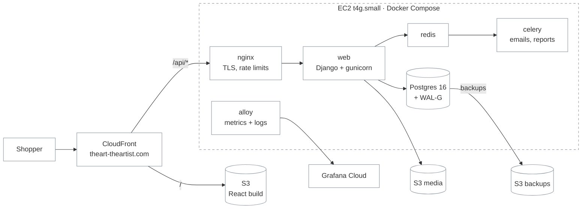
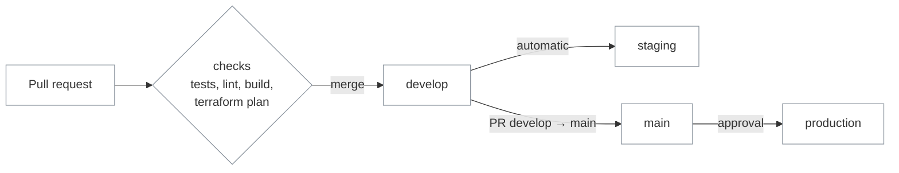

# DevOps overview — The Art — The Artist

How the online store gets from a pull request to customers, and how we know it keeps working.
A walkthrough for the project demo; every section links to the detailed doc.

_Max, DevOps · October 2026_

## 1. The task

| Constraint | What it meant |
|---|---|
| **~$30/month** for everything (AWS budget alarm at $30) | no managed Kubernetes, no RDS, no NAT gateway, free tiers where they are good enough |
| **One DevOps** for a team of backend + frontend devs | automate everything that repeats, document the rest |
| **Public repository** | no secrets, emails or account keys in git or in CI logs |
| **Two environments** (staging + production), real domain, HTTPS, payments later | same code and images in both, only config differs |
| **Everything as code** | Terraform for AWS and Grafana, Docker Compose for the servers, GitHub Actions for delivery |

Timeline: repo started 2026-08-29 → first production release **v0.1.0 on 2026-10-01** → **v0.5.1 by 2026-10-17** (15 tagged releases).

## 2. Architecture

- **One small server per environment** (ARM, Auto Scaling group of 1): it heals itself, and the data lives on a separate encrypted volume that survives instance replacement.
- **CloudFront in front of everything**: HTTPS on the domain, caching for the frontend, and the server accepts traffic **from CloudFront only** (security group with AWS's prefix list). No SSH port at all.
- **Staging** is the same stack on a t4g.micro that runs 08:00–20:00 Kyiv only (~$8/month).

Details: [infrastructure.md](infrastructure.md)

## 3. Key decisions and trade-offs

| Decision | Instead of | Why | Price we pay |
|---|---|---|---|
| EC2 + Docker Compose | ECS / EKS | fits the budget, simple to debug, same compose file everywhere | one server: a deploy = ~3 s of 502s |
| Postgres in a container + WAL-G to S3 | RDS | RDS alone would cost most of the budget | we own backups → restore drills (§7) |
| SSM Session Manager | SSH + keys | no open port, no keys to lose, access via IAM + MFA | needs the AWS CLI plugin |
| GitHub OIDC roles | AWS keys in GitHub | nothing long-lived to leak; each role only for its branch/environment | more IAM to set up once |
| Secrets in SSM Parameter Store | `.env` files, Secrets Manager | free, encrypted, read by the server's own role at deploy | created by hand (never in Terraform state) |
| Grafana Cloud Free + Alloy | self-hosted Prometheus/Loki | no extra server; 14 days retention is enough | Free plan limits (synthetic checks are the tightest) |
| Resend for email (for now) | Amazon SES | AWS rejected SES production access for the new account | 100 emails/day; SES is ready to switch back |

## 4. Delivery: from PR to production

- **Release pipeline**: test → build ARM images (tag = commit SHA) → push to ECR → deploy via SSM → smoke check. The same image goes to staging and then to production.
- **Rollback** = re-run the workflow with an older image tag. No rebuild, no git surgery.
- **Infrastructure has its own pipeline**: Terraform plan as a PR comment, apply on merge (production after approval).
- **Guardrails**: PRs into `main` only from `develop`, merge commits only, production deploys need approval, each environment has its own AWS role.
- **Housekeeping is automated too**: Dependabot (monthly, grouped), a monthly check for a newer server image (AMI) that opens an issue.

Details: [releasing.md](releasing.md), [ci-cd.md](ci-cd.md)

## 5. Everything as code

| Layer | Tool | Where |
|---|---|---|
| AWS: network, servers, buckets, CDN, DNS, certificates, email, IAM for CI, budget (~100 resources) | Terraform | `infra/` |
| Monitoring: alert rules, contact point, synthetic checks, 5 dashboards | Terraform + a dashboard generator | `infra/grafana/` |
| What runs on a server | Docker Compose, nginx template | `docker-compose.prod.yml`, `nginx/` |
| Database image with backups | Dockerfile | `db/` |
| Delivery | GitHub Actions (8 workflows) | `.github/workflows/` |

**Deliberately manual**: secret values and human IAM users (passwords and secrets must not end up in Terraform state or a public repo). Both are documented: [secrets.md](secrets.md).

## 6. Security

- **No open admin doors**: no SSH, server reachable only from CloudFront, buckets private, TLS everywhere (CloudFront → server too, with an auto-renewing Let's Encrypt certificate).
- **No long-lived keys in CI**: GitHub → AWS via OIDC, one role per job type with guardrails (the apply role cannot read secrets or touch human IAM).
- **Least privilege for people**: devs get view-only + a server shell, analysts can only download their weekly reports, MFA forced.
- **Abuse protection**: nginx rate limits on login, sign-up, password reset and checkout (also protects the email quota).
- **Secrets**: SSM SecureString, inventory + rotation procedure; first rotation done 2026-10-17. Payments logs never leave the server.

## 7. Reliability: backups we have actually restored

- **Backups**: full base backup every night + WAL (every change) at least every 5 minutes → **at most ~5 minutes of data lost** if the server disappears. Old backups move to Glacier, then expire.
- **Restore drills**, timed:

| Date | Drill | Result |
|---|---|---|
| 2026-10-02 | A — restore next to prod in a throwaway container | all 24 tables match, fetch 3.4 s |
| 2026-10-14 | B — real procedure on staging, data folder removed | all 27 tables match, site back in **~1 minute** |

- **Self-healing**: if the instance dies, the Auto Scaling group starts a new one, which re-attaches the data volume and IP and deploys itself from SSM.

Details: [database-restore.md](database-restore.md)

## 8. Observability

- **Alloy** on each server ships host, container and Postgres metrics plus logs (nginx JSON, Django with full tracebacks) to **Grafana Cloud**.
- **5 dashboards**, all with an environment switch and **release markers** (every deploy draws a line, so "did the release cause it?" takes one glance):
  Overview → Requests (rate, errors, duration) · Infrastructure (server + containers) · Database · Logs.
- **10 alert rules** (site/frontend down, 5xx, app errors, disk, memory, metrics missing, backup failed/missing, WAL archiving, certificate expiry), each with a **runbook** link: [alerts.md](alerts.md).
- **Synthetic checks** from three European locations open the admin login to the admin page and load the frontend.

## 9. Performance: a load test that found a real bug

k6 script simulating shoppers browsing the catalog, run on staging while watching the dashboards ([loadtest/README.md](../loadtest/README.md)).

| Run (staging, t4g.micro) | Shoppers | p95 | Errors |
|---|---|---|---|
| load | 20 | 137 ms | 0 % |
| stress, before fix | 100 | **3.1 s** | 8 × 500 |
| stress, after fix | 100 | **162 ms** | **0** |

**What it found:** Django opened a **new database connection for every request** (the default). At ~70 requests/s that meant 70 DNS lookups, TCP handshakes and Postgres processes per second: Docker's DNS occasionally failed (500s) and requests queued. The logs in Grafana pointed straight at it. **Fix:** one setting (`CONN_MAX_AGE`) → p95 ~19× lower, database CPU down 70 %, no errors. Staging handled 100 simultaneous shoppers at 37 % CPU; production is twice the size.

## 10. Cost

| | Monthly |
|---|---|
| Production (EC2, volumes, IP, CloudFront, S3, Route 53) | ~$22 |
| Staging (runs 12 h/day) | ~$8 |
| Grafana Cloud, GitHub Actions (public repo), Resend | $0 |
| **Total** | **≈ $30**, alarm at 80 % forecast and 100 % |

## 11. Lessons learned

- **Measure, don't guess.** The load test's bottleneck was not CPU or gunicorn workers, as expected, but connection handling — visible only by combining metrics and logs.
- **Docker DNS and restarts**: nginx cached the old IP of `web` after a redeploy (502s) → resolve per request (v0.4.1).
- **Real limits show up late**: EC2 user data is limited to 16 KB (→ gzip), AWS can reject SES for a young account (→ Resend fallback, SES kept ready).
- **Scripts need guards**: a failed secret-generation step silently reused the previous value → rotation procedure now checks the length before every write.
- **Backups only count when restored**: two drills, timed, written down.

## 12. What's next

- Product photos through CloudFront (caching) instead of signed S3 links.
- Extra protection for `/api/admin/`.
- Frontend monitoring (Grafana Faro).
- SES production access (re-apply November), WayForPay keys.
- Move Grafana and email accounts to the customer; [handover.md](handover.md).
