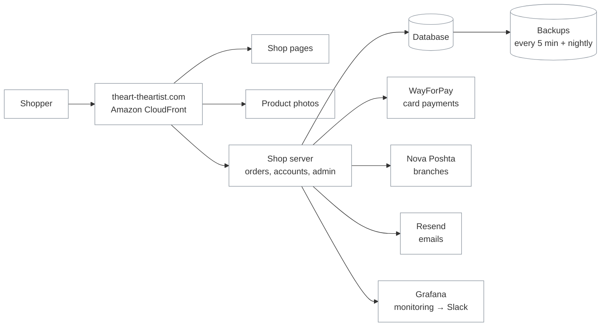

# Owner guide — The Art — The Artist

What the online shop runs on, what you own, how it is protected and what to do when something
happens. No technical background needed; the technical details are in the other docs
(links at the end).

_November 2026_

## 1. In one picture

- **Amazon Web Services (AWS)** hosts everything: the shop pages, the photos, the server with the
  database and the backups. One account, in Frankfurt.
- **CloudFront** is the front door: every visitor goes through it. It serves pages and photos
  fast from servers close to the visitor and is the only way to reach the shop server.
- There is a **test copy of the shop** at `staging.theart-theartist.com`. Every change is tried there
  first and reaches the real shop only in a **release**.

## 2. What you own

| Account | What it is for | Status |
|---|---|---|
| **AWS** | Hosting: server, database, backups, photos, domain DNS | yours |
| **Domain** `theart-theartist.com` (GoDaddy) | The shop's address. Renews 2027-10-03 (auto-renew on) | yours |
| **WayForPay** | Card payments, money goes to your account | yours |
| **Resend** | Sends the shop's emails (sign-up, password reset, orders) | yours |
| **Grafana Cloud** | Monitoring: is the shop up, errors, speed, backups | yours |
| **Slack**, channel `#alerts` | Where problem notifications arrive | check: who is the owner |
| **Google Analytics** | Visitors and sales statistics | check: who is the owner |
| **GitHub** `MateTeam251/brand-clothing-tp251` | The shop's code and its history | team's organization |

Keep the passwords of these accounts with two-factor login on, and give people their **own** access
(never share your login).

## 3. Reliability

- **Backups.** The database is copied to separate storage **at least every 5 minutes**, plus a full
  copy every night. In the worst case (the server is lost completely) at most **~5 minutes** of
  orders would be lost. Restoring has been **tested twice** (October 2026): the shop was back in about
  a minute with all data intact.
- **Self-healing.** If the server fails, AWS starts a new one automatically; the data lives on a
  separate disk and is reattached.
- **Load.** Tested with **100 shoppers browsing at the same time**: pages answered in under 0.2 s,
  no errors, the server at about a third of its capacity.
- **Updates.** A release causes about **3 seconds** of unavailability. Releases are done at quiet times.

## 4. Monitoring

- The shop is checked **every few minutes from three European cities**. If it does not answer,
  the team gets a notification in **Slack `#alerts`** (and by email).
- Other notifications: errors on the site, disk or memory running out, a failed backup, the security
  certificate close to expiring. Each has written instructions for the developer on duty.
- You can open the dashboards in Grafana (Overview) to see visitors, speed and errors yourself.

## 5. Security

- The shop works only over **HTTPS** (padlock in the browser). Certificates renew automatically.
- The server **cannot be reached directly**, only through CloudFront. There is no remote login with
  passwords; technical access needs an AWS account with two-factor login.
- Login, registration, password reset and checkout are **limited per visitor**, against password
  guessing and spam.
- Passwords and keys (payment, email, database) are stored encrypted in AWS, never in the code.
- Card data never touches the shop: it is entered on WayForPay's page.

## 6. Costs

| | Per month |
|---|---|
| AWS (shop + test copy) | about **$30**; an email alert is sent at $30 |
| Grafana, Resend, GitHub | **$0** (free plans) |
| Domain | yearly GoDaddy renewal (see your GoDaddy account) |
| WayForPay | a percentage of each payment (see your WayForPay contract) |

Costs grow with traffic and photos (storage, data sent to visitors) and if a bigger server is needed.
Free plan limits: Resend **100 emails per day / 3,000 per month**; Grafana 14 days of history.

## 7. What if…

| Situation | What to do |
|---|---|
| The shop does not open | Check `#alerts` in Slack. If there is no alert, open the site from another network or phone. Then contact your developer; instructions are in `docs/alerts.md` |
| You need to change the payment account | Change it in WayForPay, then the developer updates the keys (one setting, ~10 minutes) |
| A new team member needs access | Give them their **own** user: admin of the shop (Django admin), AWS, Grafana, Slack. Never share a login |
| Someone leaves the team | Remove their users and ask the developer to change the keys they could see (`docs/secrets.md`) |
| A new developer takes over | They start with `docs/handover.md` |
| An email from AWS about the budget | Spend is close to $30: ask the developer what grew |

## 8. Technical docs

| Doc | For |
|---|---|
| [handover.md](handover.md) | The developer who runs the infrastructure: access, routines, checklist |
| [infrastructure.md](infrastructure.md) | Everything in AWS, in detail |
| [devops-overview.md](devops-overview.md) | How it was built and why (architecture, decisions, results) |
| [releasing.md](releasing.md) | How changes get to the shop, version history |
| [alerts.md](alerts.md) | What to do for each notification |
| [database-restore.md](database-restore.md) | Restoring the database from backups |
| [secrets.md](secrets.md) | Where every password and key is kept, how to change it |
